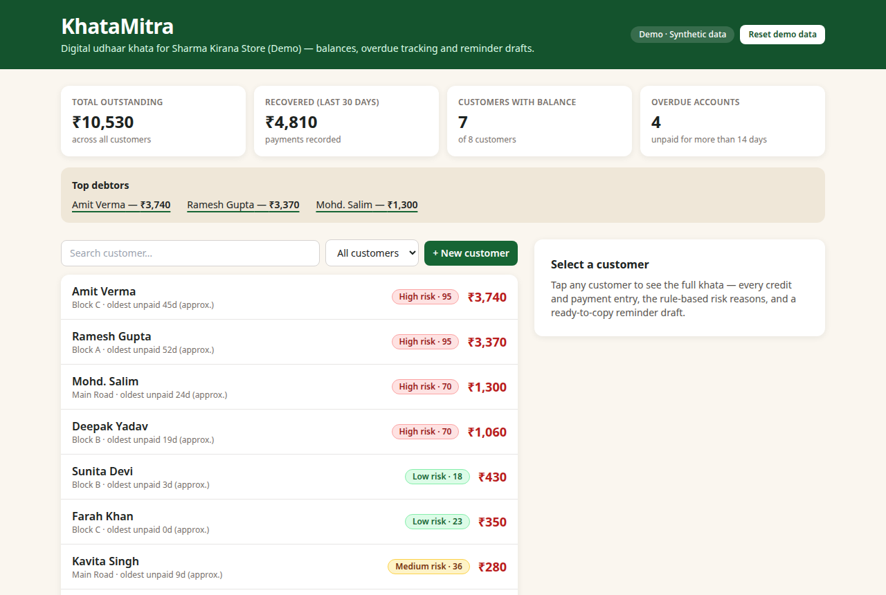
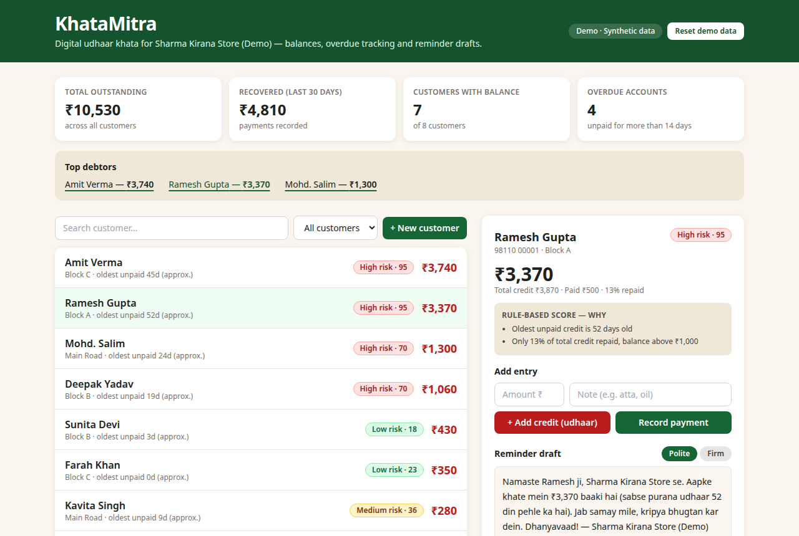
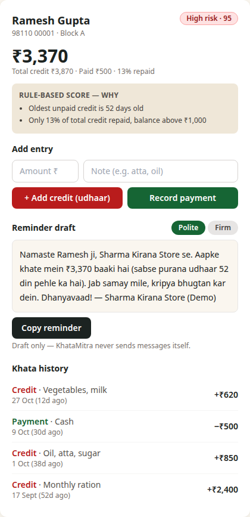

# KhataMitra — Digital Udhaar Khata for Kirana Shops

**Built for BUiLDX (BuildX 36 Hours Online Hackathon), Code-A-Nova** · Track: **FinTech & Digital Economy** · Team Tech Bro (Pintu Kumar, solo)

🔗 **Live app:** https://buildx-khatamitra.vercel.app

## Problem
Small kirana shopkeepers in India give informal credit (*udhaar*) and track it in paper notebooks. There are no running totals, no overdue view, and no systematic follow-up — so money is recovered late, disputed, or never recovered at all.

## Solution
KhataMitra replaces the paper khata with a simple digital ledger the shopkeeper can run from a phone or shop computer:

- **Dashboard** — total outstanding, recovered in the last 30 days, customers with a balance, overdue accounts, top debtors.
- **Customer khata** — running balance and full entry history per customer (credit + payments, with dates and notes).
- **Add credit / record payment** — two-tap entry flows with validation (no over-payment beyond the balance due).
- **Overdue & risk view** — search and filters (overdue only, risk band), with a **rule-based repayment-risk score** per customer. The rules are plain and published (days outstanding + repayment history) — it is *not* AI/ML and is labelled as rule-based everywhere in the app.
- **Reminder drafts** — polite and firm WhatsApp-style message drafts generated from the customer's real ledger balance. The shopkeeper copies and sends them himself; the app never sends messages.
- **Local-first** — no account, no backend; everything persists in browser localStorage and works offline after load.

## Screenshots




## Tech stack
React 19 · TypeScript · Vite · Tailwind CSS · localStorage persistence · deployed on Vercel.

Scoring logic: `src/lib/scoring.ts` (pure, deterministic). Seed data: `src/data/seed.ts`. Spec pack: `spec/SPEC.md`, `spec/DESIGN.md`, `spec/TASKS.md`. Submission deck: `deck/`.

## Run locally
```bash
npm install
npm run dev        # http://localhost:5173
npm run build      # production build (typecheck + vite build)
npm run typecheck
```

## Data honesty note
All customers, amounts, phone numbers and the shop itself in the demo are **fictional synthetic data**, labelled as such in the app. No real people, no real transactions, no user or revenue claims. The "recovered" and "outstanding" figures are computed from that seed data only.

## Roadmap (post-hackathon ideas)
UPI payment links in reminders, Hindi UI, printable monthly statements, optional cloud backup, and a second-shop pilot with real feedback before any claims are made.
